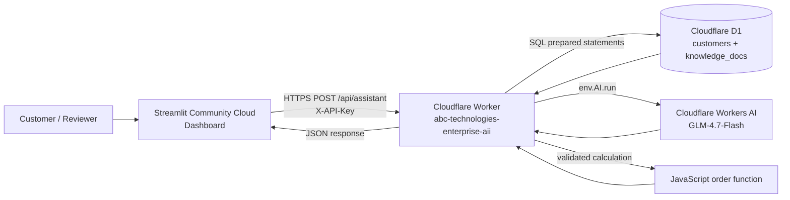
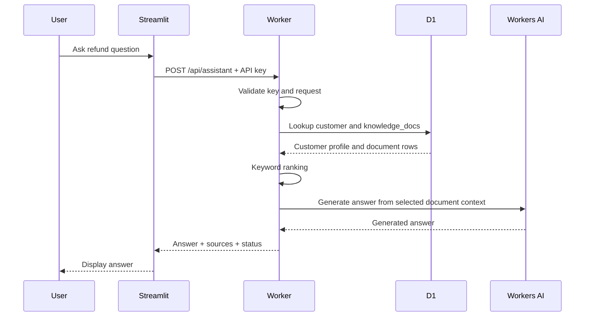
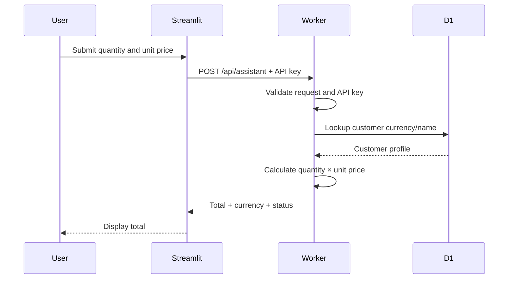

# ABC Technologies Enterprise AI — Architecture

**Status:** Public portfolio/demo deployment  
**Last documented:** 7 November 2026

## 1. Purpose

The application demonstrates an enterprise-style interface for answering questions about a small company knowledge base and calculating sample customer orders. It uses a lightweight serverless deployment so the model is not loaded into the Streamlit process.

## 2. Deployed system diagram



## 3. Components and responsibilities

### 3.1 Streamlit Community Cloud — frontend

File: `frontend/streamlit_app.py`

The dashboard provides three modules:

1. **Overview:** calls `GET /health` and displays service health.
2. **Policy Assistant:** sends a customer ID and question to `POST /api/assistant` with `intent: "question"`.
3. **Order Calculator:** sends customer ID, quantity, and unit price with `intent: "calculate"`.

The frontend reads `API_URL` and `API_KEY` from Streamlit Secrets. The key is sent in the `X-API-Key` header. It must not be committed to GitHub.

### 3.2 Cloudflare Worker — API gateway and application logic

Files:

- `cloudflare_worker/src/index.js`
- `cloudflare_worker/wrangler.toml`

The Worker exposes:

| Route | Method | Authentication | Purpose |
|---|---|---|---|
| `/health` | GET | Public | Checks D1 access, customer row count, and AI binding presence |
| `/api/assistant` | POST | `X-API-Key` | Routes policy questions and calculations |

The Worker validates request shape, customer ID, question length, quantity, and unit price. It returns JSON responses and HTTP error codes for invalid or unauthorized requests.

### 3.3 Cloudflare D1 — application data

Database: `abc-technologies-db`  
Binding: `DB`

Tables:

**`customers`**

- `customer_id` (primary key)
- `customer_name`
- `preferred_currency`
- `product_unit_price`
- `preferred_contact`

**`knowledge_docs`**

- `doc_id` (primary key)
- `title`
- `source`
- `content`

The initial migration is `cloudflare_worker/migrations/0001_init.sql`. It inserts two demonstration customer profiles and three company knowledge documents.

### 3.4 Cloudflare Workers AI — answer generation

Binding: `AI`  
Model identifier in the Worker source: `@cf/zai-org/glm-4.7-flash`

For policy questions, the Worker retrieves the available D1 knowledge documents, ranks them using simple keyword overlap, and passes the selected text plus customer preferences to the model. The answer includes the selected document sources.

### 3.5 Order calculation

For `intent: "calculate"`, the Worker validates the numeric inputs and calculates `quantity × unit_price`. The result is returned with the customer's preferred currency.

This public function is implemented directly in JavaScript. It is **not** an invocation of the separate MCP server built in the Colab prototype.

## 4. Request flows

### 4.1 Policy question



### 4.2 Order calculation



## 5. API contract

Base URL:

`https://abc-technologies-enterprise-aii.panhwarshahzadali91.workers.dev`

### Health check

`GET /health`

Expected healthy fields include `status: "healthy"`, `database: "connected"`, `customer_records: 2`, and `ai_binding: true`.

### Policy question

`POST /api/assistant`

Headers:

- `Content-Type: application/json`
- `X-API-Key: <APP_API_KEY>`

Example body:

```json
{
  "customer_id": "customer_001",
  "intent": "question",
  "question": "How many days do I have to request a refund?"
}
```

### Order calculation

`POST /api/assistant`

```json
{
  "customer_id": "customer_001",
  "intent": "calculate",
  "quantity": 8,
  "unit_price": 350
}
```

Expected demo result: `total: 2800`, `currency: "PKR"`.

## 6. Environment and secrets

### Cloudflare Worker

- D1 binding: `DB`
- Workers AI binding: `AI`
- Encrypted Worker secret: `APP_API_KEY`

### Streamlit Community Cloud

```toml
API_URL = "https://abc-technologies-enterprise-aii.panhwarshahzadali91.workers.dev"
API_KEY = "<same value as Cloudflare APP_API_KEY>"
```

Never place the real key in source code, screenshots, public issues, or Git commits. Rotate it if exposed.

## 7. Current verification record

Manual results reported by the project owner on 7 November 2026:

| Test | Result |
|---|---|
| Worker `/health` | HTTP 200; D1 connected; two customer rows; AI binding present |
| Ahmed refund policy question | HTTP 200; answer states 7 calendar days |
| Ahmed calculation: 8 × 350 | HTTP 200; total 2,800 PKR |
| Invalid API key | HTTP 401 |
| Streamlit Overview | Dashboard deployed; health-check control used |
| Streamlit Policy Assistant | Successful test |
| Streamlit Order Calculator | Successful test |

These results are user-reported manual functional tests. They do not constitute independent penetration testing, load testing, or a formal compliance review.

## 8. Important scope boundaries

The public deployment is a **serverless adaptation** of the larger learning capstone. The two implementations must be distinguished:

| Capability | Colab prototype | Public deployed version |
|---|---|---|
| LLM | Qwen model | Cloudflare Workers AI GLM-4.7-Flash |
| Retrieval | FAISS semantic retrieval and reranking | D1 documents with simple keyword-overlap ranking |
| Orchestration | LangGraph graphs | Direct Worker request routing |
| Business calculation | MCP calculator tool | Native JavaScript Worker function |
| Customer memory | LangGraph long-term store / JSON backup | D1 customer table lookup |
| Human approval | Simulated LangGraph interrupt/resume workflow | Not implemented in public Worker |

The public application therefore does not currently run the original LangGraph graph, FAISS index, separate MCP server, or human-in-the-loop workflow.

## 9. Security, reliability, and free-tier considerations

Before using real customer data or business transactions, add:

- Individual customer identity and authorization; the current demo customer IDs are selectable in the public dashboard.
- Per-user or per-tenant access control; an application API key alone is not end-user authentication.
- Rate limiting, request-size limits, abuse monitoring, and audit logs.
- More restrictive CORS rules aligned to the exact deployed Streamlit origin.
- Database backup/restore procedures and data-retention rules.
- Human approval for refunds, order changes, or other consequential actions.
- Monitoring of Workers AI and D1 quotas, error rates, and latency.

The free tiers have quotas and operational limits. Check the current platform plans before relying on the services for continuous or commercial use. A free-tier deployment is not a service-level guarantee.

## 10. Official references

- [Cloudflare Workers bindings](https://developers.cloudflare.com/workers/runtime-apis/bindings/)
- [Cloudflare D1 Worker API](https://developers.cloudflare.com/d1/worker-api/)
- [Cloudflare Workers AI pricing and free allocation](https://developers.cloudflare.com/workers-ai/platform/pricing/)
- [Streamlit Community Cloud deployment](https://docs.streamlit.io/deploy/streamlit-community-cloud/deploy-your-app/deploy)
- [Streamlit Community Cloud secrets management](https://docs.streamlit.io/deploy/streamlit-community-cloud/deploy-your-app/secrets-management)
