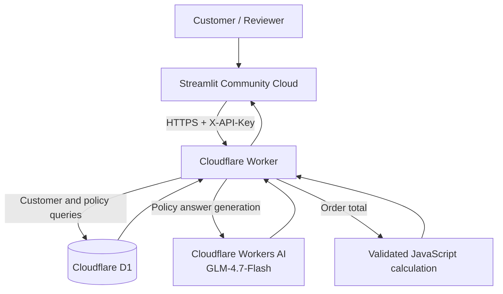

# ABC Technologies Enterprise AI

A publicly deployed portfolio demonstration of an enterprise-style AI assistant for company-policy questions and order calculations.

**Live dashboard:** [ABC Technologies Enterprise AI](https://abc-technologies-enterprise-ai-by-shahzad-panhwar.streamlit.app)  
**Cloudflare API gateway:** [Worker health endpoint](https://abc-technologies-enterprise-aii.panhwarshahzadali91.workers.dev/health)  
**Source repository:** [ShahzadAli166/ABC-Technologies-Enterprise-AI](https://github.com/ShahzadAli166/ABC-Technologies-Enterprise-AI)

## What it does

- Provides a Streamlit dashboard with an overview, customer-policy assistant, and order calculator.
- Sends authenticated requests from Streamlit to a Cloudflare Worker API gateway.
- Looks up demo customer profiles and company-policy documents in Cloudflare D1.
- Uses Cloudflare Workers AI with `@cf/zai-org/glm-4.7-flash` to generate policy answers grounded in retrieved D1 documents.
- Calculates order totals in a validated JavaScript Worker function.

## Current deployed architecture



See [Architecture](ABC_Technologies_GitHub_Repository/docs/ARCHITECTURE.md) for details and limitations.

## Repository layout

```text
ABC-Technologies-Enterprise-AI/
├── README.md
└── ABC_Technologies_GitHub_Repository/
    ├── README.md
    ├── cloudflare_worker/
    │   ├── migrations/0001_init.sql
    │   ├── src/index.js
    │   └── wrangler.toml
    ├── frontend/
    │   ├── streamlit_app.py
    │   └── requirements.txt
    └── docs/
        ├── ARCHITECTURE.md
        └── CASE_STUDY.md
```

## Run locally

### Streamlit frontend

From `ABC_Technologies_GitHub_Repository/frontend`:

```bash
pip install -r requirements.txt
streamlit run streamlit_app.py
```

Configure these Streamlit secrets (do not commit them):

```toml
API_URL = "https://abc-technologies-enterprise-aii.panhwarshahzadali91.workers.dev"
API_KEY = "<the same secret configured as APP_API_KEY in Cloudflare>"
```

The deployed dashboard reads `API_URL` and `API_KEY` from `st.secrets`.

### Cloudflare Worker

The Worker source is in `ABC_Technologies_GitHub_Repository/cloudflare_worker`. Its Wrangler configuration declares:

- D1 binding `DB` for `abc-technologies-db`.
- Workers AI binding `AI`.
- Worker name `abc-technologies-enterprise-aii`.

The Worker also requires the encrypted secret `APP_API_KEY`. Do not place the secret in source control.

## API

Base URL:

```text
https://abc-technologies-enterprise-aii.panhwarshahzadali91.workers.dev
```

### Health

`GET /health` is public and checks D1 connectivity and the AI binding.

### Policy question

`POST /api/assistant`

Header:

```text
X-API-Key: <APP_API_KEY>
Content-Type: application/json
```

Body:

```json
{
  "customer_id": "customer_001",
  "intent": "question",
  "question": "How many days do I have to request a refund?"
}
```

### Order calculation

`POST /api/assistant`

```json
{
  "customer_id": "customer_001",
  "intent": "calculate",
  "quantity": 8,
  "unit_price": 350
}
```

For the demo profile Ahmed (PKR), the expected total is `2800`.

## Demo data

The D1 database currently contains two sample customer records:

- `customer_001`: Ahmed, PKR, preferred contact Email, saved unit price 350.
- `customer_002`: Sara, USD, saved unit price 50.

The knowledge table contains three sample documents: Customer Refund Policy, Order Processing Policy, and Customer Support Guidelines. These are demonstration records, not a real company's authoritative policies or real customer data.

## Verification performed

The project owner reported successful tests on 7 November 2026:

- `GET /health`: HTTP 200; D1 connected; two customer records; AI binding available.
- Policy request for Ahmed: HTTP 200; answer correctly stated 7 calendar days.
- Order calculation for 8 × 350: HTTP 200; total 2,800 PKR.
- Invalid API key: HTTP 401.
- Streamlit dashboard: deployed; Overview, Policy Assistant, and Order Calculator tested successfully.

These are manual project test results, not an independent security audit or load test.

## Current scope and important limitations

This public deployment is a simplified serverless adaptation of the larger Google Colab capstone:

- Public language model: Cloudflare Workers AI `@cf/zai-org/glm-4.7-flash` (not the original Colab Qwen model).
- Public retrieval: D1 document lookup with simple keyword-overlap ranking (not the Colab FAISS semantic retrieval pipeline).
- Public order calculation: a native JavaScript function in the Worker (not a remote MCP tool invocation).
- Public request routing: Cloudflare Worker logic (not the original LangGraph graph runtime).
- The original LangGraph, Qwen, FAISS, MCP, and human-in-the-loop work remains part of the Colab prototype and is not all running in the public deployment.
- The demo uses sample customer IDs; it does not yet provide per-customer login, identity verification, or tenant isolation suitable for real customer data.

Treat this as a portfolio/demo application, not a production system for sensitive customer information or real financial transactions.

## Security and operations

- Keep `APP_API_KEY` in Cloudflare Worker Secrets and `API_KEY` in Streamlit Secrets. Never commit either value.
- Rotate the API key if it is exposed.
- Do not add real customer data to the public demo database.
- Monitor Workers AI daily Neuron usage and D1 usage against the currently applicable plan quotas.
- Add stronger customer authentication/authorization, rate limiting, audit logging, and backup/restore procedures before broader use.
- Review the Cloudflare and Streamlit free-tier terms and quotas before relying on uninterrupted service.

## Documentation

- [Architecture](ABC_Technologies_GitHub_Repository/docs/ARCHITECTURE.md)
- [Project case study](ABC_Technologies_GitHub_Repository/docs/CASE_STUDY.md)

## Official platform references

- [Cloudflare Workers bindings](https://developers.cloudflare.com/workers/runtime-apis/bindings/)
- [Cloudflare D1 Worker API](https://developers.cloudflare.com/d1/worker-api/)
- [Cloudflare Workers AI pricing](https://developers.cloudflare.com/workers-ai/platform/pricing/)
- [Streamlit Community Cloud deployment](https://docs.streamlit.io/deploy/streamlit-community-cloud/deploy-your-app/deploy)
- [Streamlit Community Cloud secrets](https://docs.streamlit.io/deploy/streamlit-community-cloud/deploy-your-app/secrets-management)
